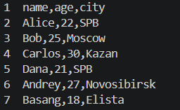
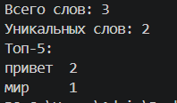
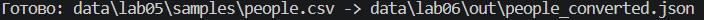
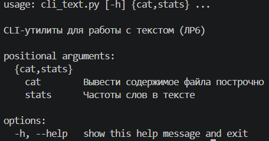
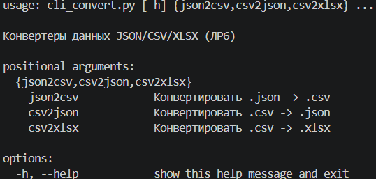

# Лабораторная работа № 6

## Описание

В лабораторной работе реализованы консольные команды для обработки текстовых
файлов и преобразования данных между форматами JSON, CSV и XLSX. Команды
запускаются из корневой папки проекта через Python-модули.

## Реализованные команды

- `cat` — выводит содержимое файла; параметр `-n` включает нумерацию строк.
- `stats` — подсчитывает частоты слов и выводит наиболее часто встречающиеся.
- `json2csv` — преобразует JSON (список словарей) в CSV.
- `csv2json` — преобразует CSV в JSON (список словарей).
- `csv2xlsx` — преобразует CSV в XLSX.

Для обработки текста используются функции из `src/lib/text.py`, а для
преобразования файлов — функции из `src/lab05`.

Для команды `csv2xlsx` требуется пакет `openpyxl`:

```powershell
python -m pip install openpyxl
```

## Сценарии запуска

### 1. Вывод содержимого файла с нумерацией строк

Команда запускается через Python-модуль, чтобы избежать конфликта имени `cat`
со встроенной командой PowerShell:

```powershell
python -m src.lab06.cli_text cat --input data/lab05/samples/people.csv -n
```

Ожидаемый результат: содержимое CSV-файла выводится в терминал, строки
пронумерованы.



### 2. Подсчёт частоты слов

```powershell
python -m src.lab06.cli_text stats --input data/lab04/input.txt --top 5
```

Ожидаемый результат: выводятся общее количество слов, количество уникальных
слов и до пяти наиболее частых слов с числом повторений. При одинаковой
частоте слова сортируются по алфавиту. Параметр `--top` должен быть
положительным числом.



### 3. Преобразование файлов

Преобразование CSV в JSON:

```powershell
python -m src.lab06.cli_convert csv2json --in data/lab05/samples/people.csv --out data/lab06/out/people_converted.json
```


Преобразование JSON в CSV:

```powershell
python -m src.lab06.cli_convert json2csv --in data/lab06/out/people_converted.json --out data/lab06/out/people_roundtrip.csv
```


Преобразование CSV в XLSX:

```powershell
python -m src.lab06.cli_convert csv2xlsx --in data/lab05/samples/people.csv --out data/lab06/out/people.xlsx
```


Ожидаемый результат: команды выполняются без ошибок и создают выходные файлы
по указанным путям. Для `json2csv` ожидается непустой JSON-массив объектов;
`csv2json` и `csv2xlsx` требуют CSV с заголовком и строками данных.


### 4. Проверка справки

Справка текстового модуля:

```powershell
python -m src.lab06.cli_text --help
```


Справка команды `cat`:

```powershell
python -m src.lab06.cli_text cat --help
```


Справка команды `stats`:

```powershell
python -m src.lab06.cli_text stats --help
```


Справка модуля преобразования:

```powershell
python -m src.lab06.cli_convert --help
```


Справка команды `json2csv`:

```powershell
python -m src.lab06.cli_convert json2csv --help
```


Справка команды `csv2json`:

```powershell
python -m src.lab06.cli_convert csv2json --help
```


Справка команды `csv2xlsx`:

```powershell
python -m src.lab06.cli_convert csv2xlsx --help
```


Ожидаемый результат: для каждого модуля и подкоманды отображаются описание
и доступные аргументы.

## Проверка результата

- `cat` выводит файл построчно, а с параметром `-n` — с нумерацией строк;
- `stats` выводит заданное количество наиболее частых слов;
- команды преобразования создают выходные файлы нужных форматов;
- справка доступна для модулей и всех подкоманд.