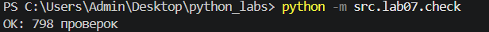
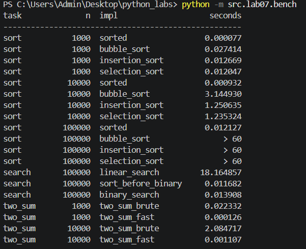

# ЛР7 — Поиск, сортировка и измерение времени

## Запуск
```bash
python -m src.lab07.check   # проверка против эталона
python -m src.lab07.bench   # бенчмарк -> data/lab07/bench.csv
```

## Результат `check.py`




## Таблица бенчмарка



## Выводы

**Квадратичные сортировки против `sorted`.** Пузырёк делает порядка n² сравнений: при росте n в 10 раз
число шагов растёт в 10² = 100 раз, поэтому время тоже растёт почти в сто раз (на практике чуть меньше
из-за накладных расходов и раннего выхода по флагу). У `sorted` (Timsort) сложность O(n log n): n растёт
в 10 раз, а log n лишь немного (10 → 13 → 17), итого рост ≈ 10·1,3 ≈ 12–13 раз. Поэтому на n = 10⁵
квадратичные сортировки это порядка 10¹⁰ шагов (около получаса), в таблице стоит «> 60», а `sorted` справился за сотые доли секунды.

**Бинарный поиск и сортировка.** Бинарный поиск опирается на то, что список упорядочен: сравнив `x` с
серединой, мы вправе отбросить половину. На неотсортированных данных это рассуждение неверно и ответ
не определён. Поэтому сортировка нужна заранее, а она стоит O(n log n). Окупается она, когда запросов
много: один линейный запрос стоит O(n), одна сортировка + k бинарных запросов — O(n log n + k log n).
В нашем замере (10 000 запросов к 100 000 элементам) сортировка + бинарные запросы заметно быстрее
10 000 линейных проходов; при одном-двух запросах выгоднее линейный поиск.
Аналогично для Two Sum: словарь тратит O(n) памяти, но вместо n² шагов делает n.

**Что показал `check.py`.** Прогнано 798 проверок (по 100 случайных списков длиной 0–50 для каждой из
трёх сортировок, затем поиск и Two Sum; списки бывают пустыми, из одного элемента, с дубликатами). Расхождений с эталоном (`sorted`, `list.index`) не найдено, исходный список
ни одна сортировка не меняет. <!-- если у тебя были баги по дороге — опиши, какие и как исправил -->